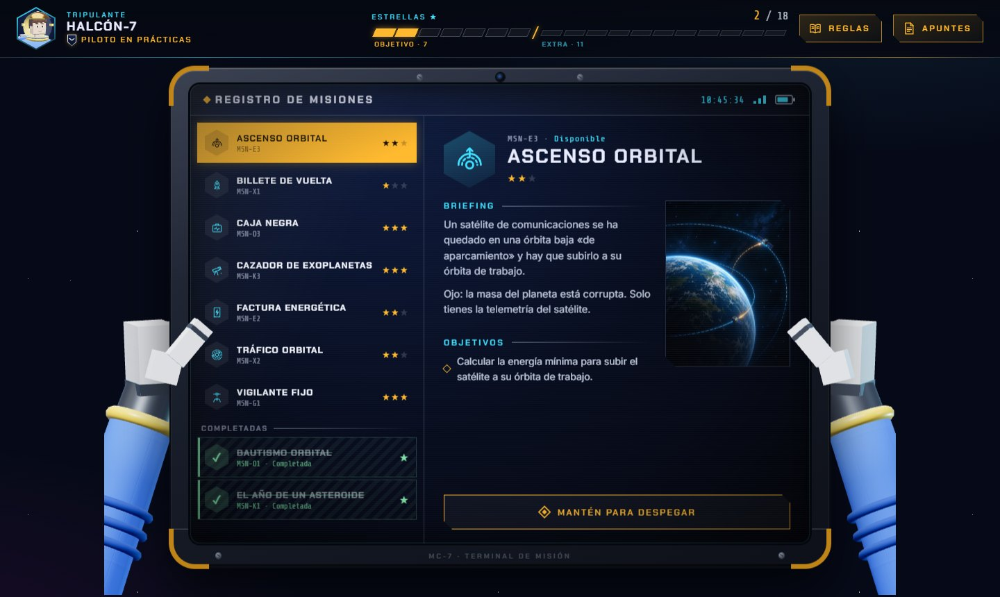
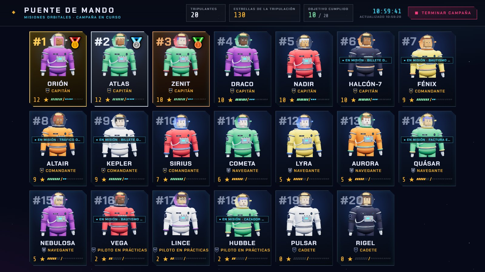

# Misiones orbitales

*Por [El profe de la bata](https://elprofedelabata.es/)*

Actividad gamificada de **campo gravitatorio** para **Física de 2.º de Bachillerato**. Cada alumno crea su astronauta y resuelve misiones en las que tiene que obtener datos de simuladores interactivos (curvas de luz, telemetría, cámaras orbitales…) y calcular un resultado: velocidades orbitales y de escape, leyes de Kepler, energía orbital, órbitas geoestacionarias, la masa de una estrella…



## Dos versiones

| | Modo práctica (web) | Versión de clase (Google Apps Script) |
|---|---|---|
| Para qué | Practicar y jugar por libre | Una sesión de clase dirigida por el profesor |
| Dónde | En el navegador, sin cuentas | Cuentas de Google Workspace del centro |
| Intentos | Ilimitados, con datos nuevos cada vez (cuenta el mejor) | Uno por misión |
| Progreso | Se guarda en el navegador | Hoja de cálculo del profesor |
| Extras | — | Puente de mando para proyectar, clasificación, ceremonia, apuntes en PDF |

### ▶ Modo práctica

**[Jugar en el navegador](https://elprofedelabata.github.io/misiones-orbitales/)**. También se puede descargar [`docs/index.html`](docs/index.html) y abrirlo con doble clic.

Es una versión para practicar: las soluciones se calculan en el propio navegador, así que **no sirve para evaluar**.

### 🏫 Versión de clase

Se instala en unos 10 minutos copiando el script de Apps Script. Todo el proceso, con capturas, está en la **[guía para el profesorado (PDF)](guia/Misiones%20orbitales%20-%20Gu%C3%ADa%20para%20el%20profesorado.pdf)**.



## Las misiones

Nueve misiones, 18 estrellas en juego y un objetivo de 7 ★. Las estrellas dependen de la precisión: error menor del 5 % → todas; menor del 10 % → una menos; menor del 25 % → dos menos.

| Misión | ★ | Contenido |
|---|---|---|
| Bautismo orbital | ★ | Velocidad orbital |
| Billete de vuelta | ★ | Velocidad de escape (elegir el mundo más fácil de abandonar) |
| El año de un asteroide | ★ | Tercera ley de Kepler |
| Factura energética | ★★ | Energía para poner un satélite en órbita |
| Ascenso orbital | ★★ | Energía para cambiar de órbita |
| Tráfico orbital | ★★ | Detectar el satélite fuera de su órbita y corregir su velocidad |
| Caja negra | ★★★ | Altura de caída a partir de la telemetría (energía potencial gravitatoria) |
| Vigilante fijo | ★★★ | Órbita síncrona de un planeta desconocido a partir de imágenes |
| Cazador de exoplanetas | ★★★ | Masa de una estrella con la curva de luz y el coronógrafo |

Cada alumno (o cada intento, en el modo práctica) tiene sus propios datos, y al entregar se muestra la resolución completa y un diagnóstico si el error coincide con uno típico.

## Estructura

```
src/            App de clase (Google Apps Script): servidor, interfaz y misiones
  Misiones.js   Generación de las misiones y corrección (común a las dos versiones)
web/            partida.js: sustituye al servidor en el modo práctica (guarda en el navegador)
docs/           Modo práctica ya construido (lo publica GitHub Pages)
herramientas/   Scripts para construir la versión web y las imágenes
imagenes/       Ilustraciones de las misiones
guia/           Guía para el profesorado (PDF y fuentes)
```

## Desarrollo

- **Versión web**: tras cambiar algo en `src/` o `web/`, reconstruye `docs/index.html` con
  ```bash
  node herramientas/construir-web.js
  ```
- **Imágenes**: si cambias las de `imagenes/`, regenera `src/Imagenes.js` con `node herramientas/generar-imagenes.js`.
- **Versión de clase**: se sube a tu proyecto de Apps Script con [clasp](https://github.com/google/clasp) (`clasp push`). El archivo `.clasp.json` no está en el repositorio: cada uno crea el suyo con su propio proyecto.

Las dos versiones comparten las misiones y la corrección (`src/Misiones.js`), así que puntúan exactamente igual.

## Autoría

Creado por **[El profe de la bata](https://elprofedelabata.es/)**.

## Licencia

[CC BY-NC-SA 4.0](https://creativecommons.org/licenses/by-nc-sa/4.0/deed.es): puedes usarlo y adaptarlo citando la autoría, sin fines comerciales y compartiendo tus adaptaciones con la misma licencia. Detalles en [LICENSE](LICENSE).
